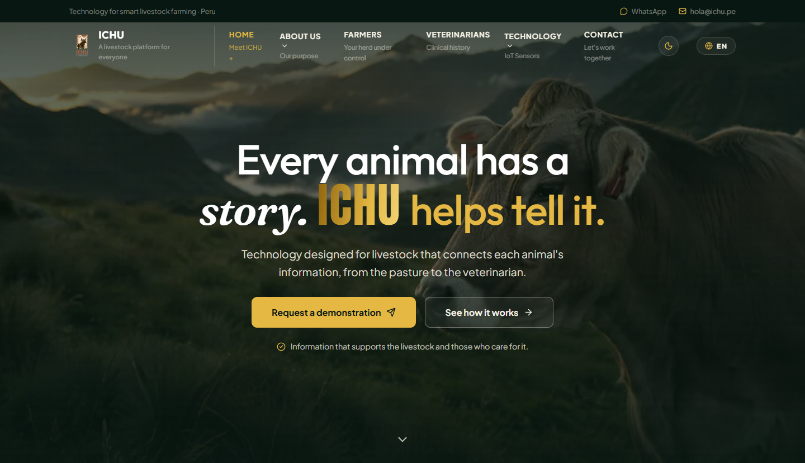

# ICHU Website

[Contributing](CONTRIBUTING.md) · [Agent guidelines](AGENTS.md)

The public website for ICHU, a Peruvian livestock technology platform. It introduces the product to farmers and veterinarians and lets visitors prepare a demonstration request through WhatsApp.



## Features

- Product information, technology overview, and media pages.
- English and Spanish, with a saved language preference.
- Responsive layouts, light and dark themes, and a custom 404 page.
- A WhatsApp contact form and an illustrative chat.

## Run locally

```sh
git clone https://github.com/five-smart-farm-creators/ichu-website.git
cd ichu-website
```

Open the folder in VS Code, install [Live Server](https://marketplace.visualstudio.com/items?itemName=ritwickdey.LiveServer), and select **Open with Live Server** on `index.html`. Any static HTTP server also works. HTTP is needed to load shared page fragments and translations.

Built with HTML, CSS, and vanilla JavaScript. No package installation or build step is required.

## Structure

| Path | Content |
| --- | --- |
| `*.html` | Home, walkthrough, media, and 404 pages |
| `assets/` | Styles, scripts, images, and videos |
| `partials/` | Shared header and footer |
| `locales/` | English and Spanish translations |

## Deployment

Publish the repository root to static hosting, preserving its folders. Configure the host to serve `404.html` with HTTP status `404` for missing pages. The recovery page assumes hosting at the domain root.

## Contributing

Follow [CONTRIBUTING.md](CONTRIBUTING.md) for Gitflow and contribution steps. Report problems or discuss larger changes in [Issues](https://github.com/five-smart-farm-creators/ichu-website/issues).

Maintained by [Five Smart Farm Creators](https://github.com/five-smart-farm-creators). A project license has not yet been specified.
